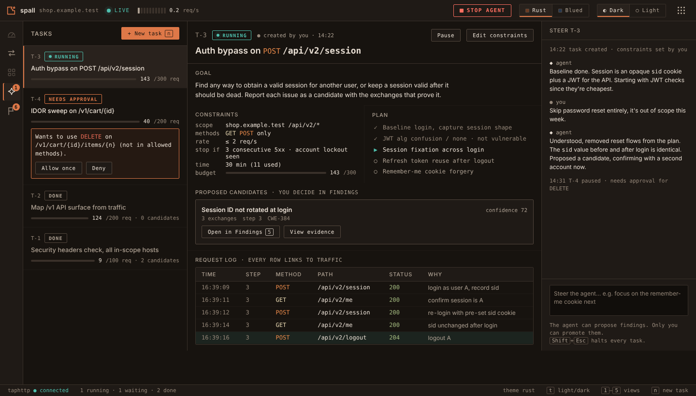
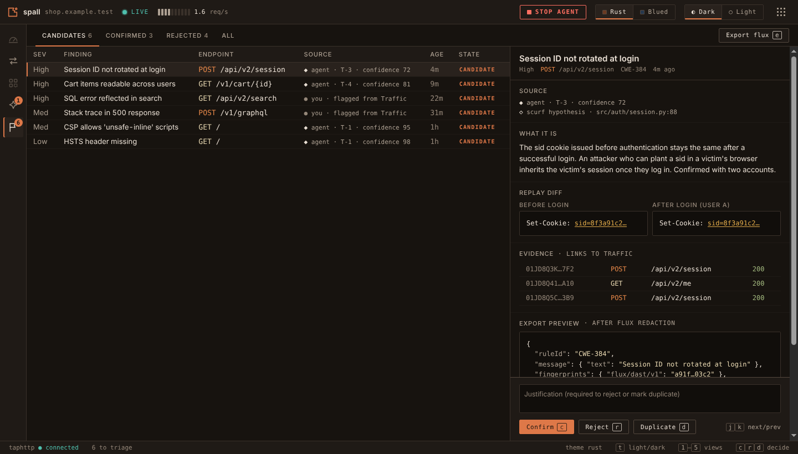

# spall

An assessment workbench for web application security testing: a web UI for interactive testing and an MCP server for agentic testing, built on top of [taphttp](https://github.com/cschooley/taphttp). Findings are exported as [flux](https://github.com/cschooley/flux), a SARIF 2.1.0 profile.

**Status:** pre-alpha. Milestone M0 ("hello": live traffic console). See [docs/architecture.md](docs/architecture.md).

**For authorized testing and local development only.** spall displays raw captured traffic, including credentials. It binds to localhost by default; keep it that way unless you have added authentication.

## Screenshots

### Today: the Traffic view (M1)

Live traffic and history from taphttp, filter syntax, the shared inspector, command palette and the `` ` `` console. Screenshots use fixture traffic; regenerate them with `npm --prefix ui run screenshots`.


### Where it's going (design mockups)

Visual direction from [verdigris](https://github.com/cschooley/verdigris), Kudzu's design system. The interactive versions live in [`verdigris/mockups`](https://github.com/cschooley/verdigris/tree/main/mockups); the UX behind them is in [docs/ux.md](docs/ux.md).

**Traffic.** Still to come: attribution on every exchange (you or the agent), and replay and flag actions in the inspector.


**Tasks.** The agent works from structured work orders: goal, constraints, request budget, plan and a linked request log. Out-of-scope actions wait for approval. STOP AGENT halts everything.



**Findings.** A triage inbox. The agent proposes, a human confirms, rejects or marks duplicate, with evidence and a redacted export preview.



## Quickstart

```sh
docker compose up --build
```

taphttp comes from its published image (`ghcr.io/cschooley/taphttp:0.3.0`, amd64 only for now; no login needed). The first `up` compiles spall, which takes a few minutes. Then, in another terminal:

```sh
curl -x http://127.0.0.1:8080 http://example.com
```

Open <http://127.0.0.1:3000> and the request appears in the console. Click a row to see headers and bodies.

Ports:

| Port | Service | Bound to |
|---|---|---|
| 8080 | taphttp HTTP proxy | 127.0.0.1 |
| 3000 | spall web console | 127.0.0.1 |

If either port is already in use, override the host side: `TAPHTTP_PORT=18080 SPALL_PORT=13000 docker compose up`. They stay bound to 127.0.0.1.

### HTTPS

taphttp terminates TLS using its own CA, so clients have to trust that CA. The CA lives in the `taphttp-ca` volume and survives restarts.

The proper way is to export the CA and trust it explicitly:

```sh
docker compose exec taphttp taphttp ca info              # where the cert is, install hints
docker compose exec taphttp taphttp ca print > taphttp-ca.pem
curl -x http://127.0.0.1:8080 --cacert taphttp-ca.pem https://example.com
```

For a quick demo only, you can skip verification:

```sh
curl -x http://127.0.0.1:8080 -k https://example.com
```

**`-k` is for this demo only.** It turns off certificate checking for the whole request. Never use it against anything you care about, and never put it in scripts.

### Where traffic comes from

In compose, spall reads traffic from taphttp's **lever API**. It backfills recent history from `GET /exchanges`, then follows the `/feed` WebSocket, resuming from the last exchange it saw after any disconnect. The API port (8081) stays on the compose network, and spall reads the API token from a read-only `taphttp-token` volume. spall never mounts taphttp's traffic or CA volumes.

taphttp's API history starts when its sqlite store is turned on, so traffic captured before that (for example, by taphttp before v0.3.0) isn't in it.

### Running without Docker

With the lever API (recommended):

```sh
taphttp start --api-listen 127.0.0.1:8081 --api-token-file ./api-token &
cargo run -- --taphttp-api http://127.0.0.1:8081 --taphttp-token-file ./api-token
```

Or tail taphttp's log file (no history search):

```sh
taphttp start --log-file ./traffic.jsonl &
cargo run -- --log-file ./traffic.jsonl
```

| Flag | Env | Default |
|---|---|---|
| `--taphttp-api` | `SPALL_TAPHTTP_API` | unset (tail `--log-file` instead). `http://host:port` only |
| `--taphttp-token-file` | `SPALL_TAPHTTP_TOKEN_FILE` | `/token/api-token` |
| `--log-file` | `SPALL_LOG_FILE` | `/data/traffic.jsonl` (used only without `--taphttp-api`) |
| `--listen` | `SPALL_LISTEN` | `127.0.0.1:3000` |
| `--proxy-address` | `SPALL_PROXY_ADDRESS` | `127.0.0.1:8080` (shown in the status bar; display only) |
| `--allowed-host` | `SPALL_ALLOWED_HOSTS` | `localhost,127.0.0.1,[::1]` |
| `--history` | `SPALL_HISTORY` | `1000` (entries replayed to a newly opened page) |
| `--poll-ms` | `SPALL_POLL_MS` | `250` (log tailing only) |

`--allowed-host` is checked against the request's `Host` header to block DNS-rebinding attacks on the local console. Requests for any other host get a 403.

## Endpoints

- `GET /`: live console
- `GET /events`: Server-Sent Events, one event per taphttp `TrafficEntry` (JSON); recent history first, then live
- `GET /api/exchanges`: history, newest first, proxied to taphttp's `GET /exchanges`. Accepts `limit`, `before`, `host`, `method`, `status`, `q`, `since`, `until`; other parameters are dropped. 503 without `--taphttp-api`
- `GET /api/exchanges/{id}`: one exchange, or 404
- `GET /api/status`: `{"source": "lever" | "log", "connected": bool | null}` for the status bar
- `GET /healthz`: `ok`

The browser never talks to taphttp or sees its token: spall adds the token server-side.

## Development

The server is Rust; the UI is React + Vite + TypeScript in `ui/`, built to `ui/dist/` and embedded in the binary. `cargo build` and `cargo test` work without Node: `/` then explains how to build the UI.

```sh
cargo test
cargo clippy --all-targets -- -D warnings
```

UI (Node 22.16, see `ui/.nvmrc`):

```sh
cd ui
npm ci               # lockfile only; install scripts are disabled (.npmrc)
npm run lint         # includes the "traffic is never HTML" bans
npm test             # node:test, no browser
npm run test:e2e     # Playwright: builds the UI, runs spall via cargo, headless Chromium
npm run screenshots  # regenerate docs/screenshots/traffic*.png (1440x820, fixture traffic)
npm run build        # then rebuild spall to embed ui/dist
npm run dev          # Vite on 127.0.0.1:5173, proxying /events and /api to spall on :3000
```

Browser tests need a Chromium: either Playwright's (`npx playwright install chromium`, about 100 MB; `ignore-scripts` stops the automatic download), or any recent one via `SPALL_E2E_CHROMIUM=/usr/bin/chromium npm run test:e2e`. Every test fails on a console error, page error, dialog or CSP violation.

Adding an npm dependency: pick a version published at least two weeks ago, and resolve the whole tree as of a date at least two weeks back (`npm install --before=<date>`), so transitive dependencies follow the same rule.

## Provenance

Built with Claude Code, human-directed and reviewed.
