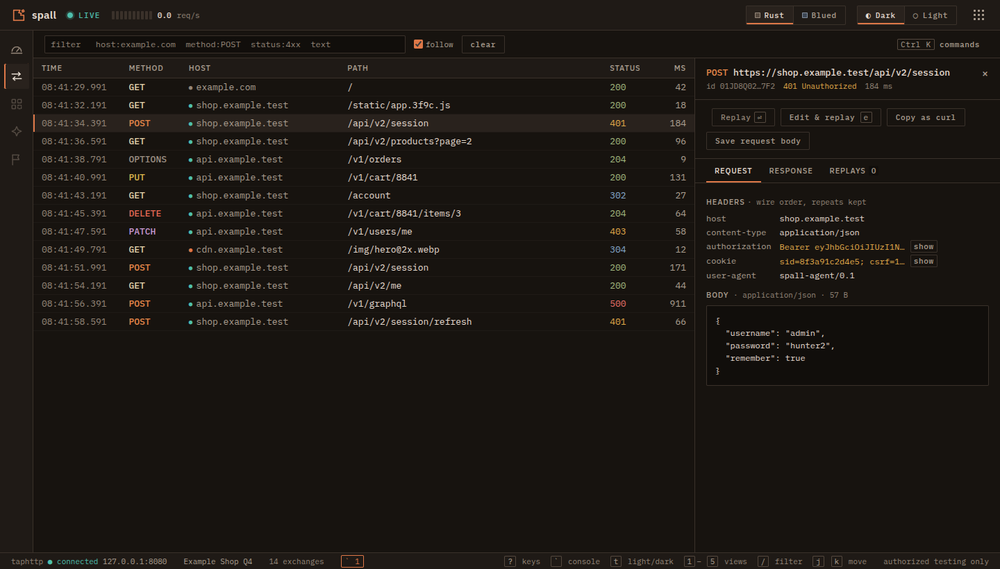
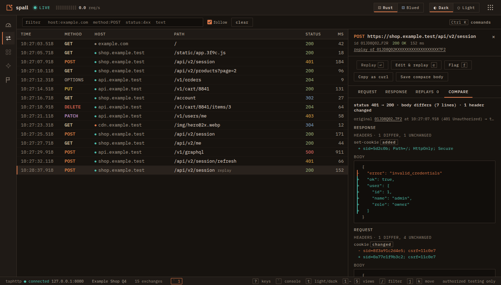
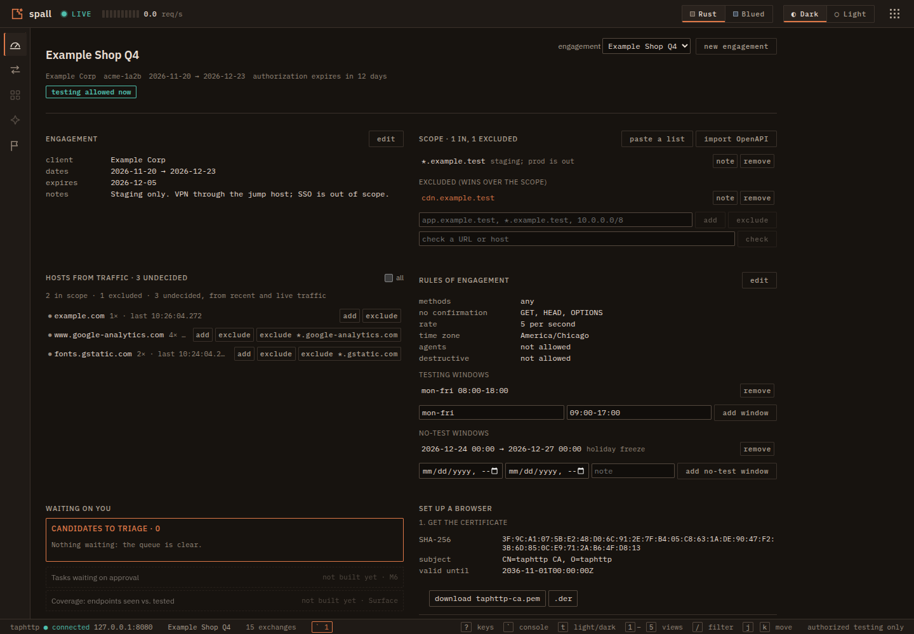
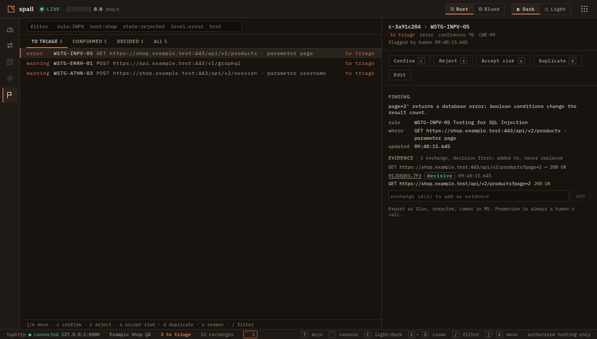
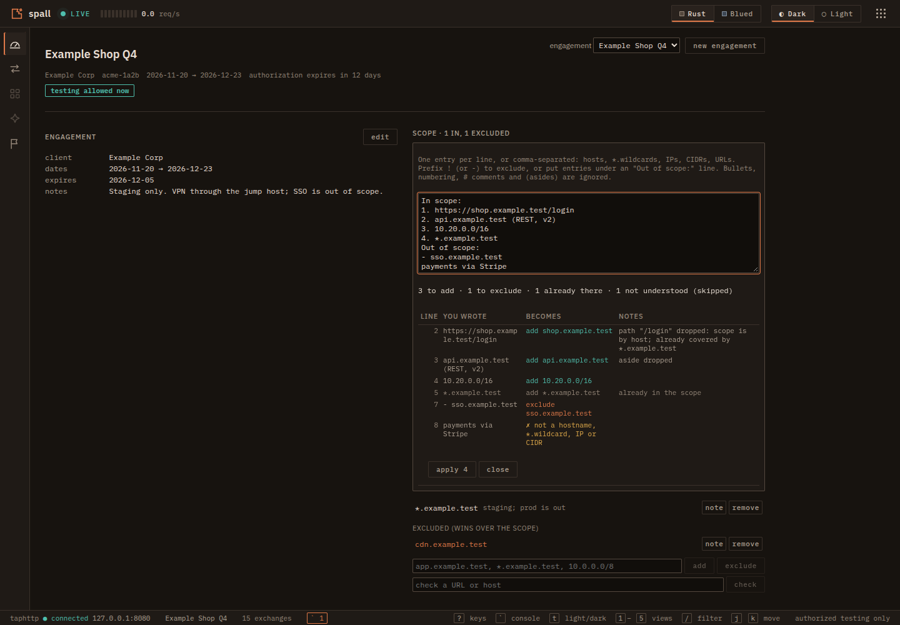
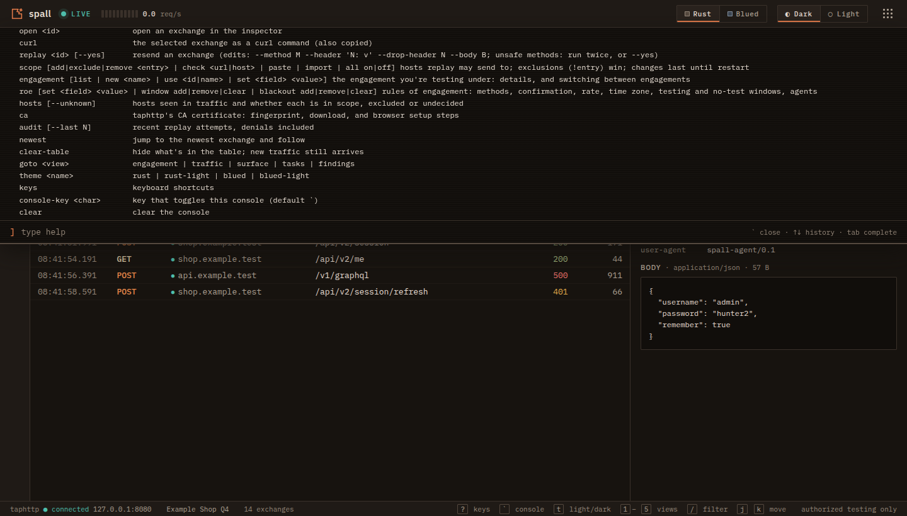
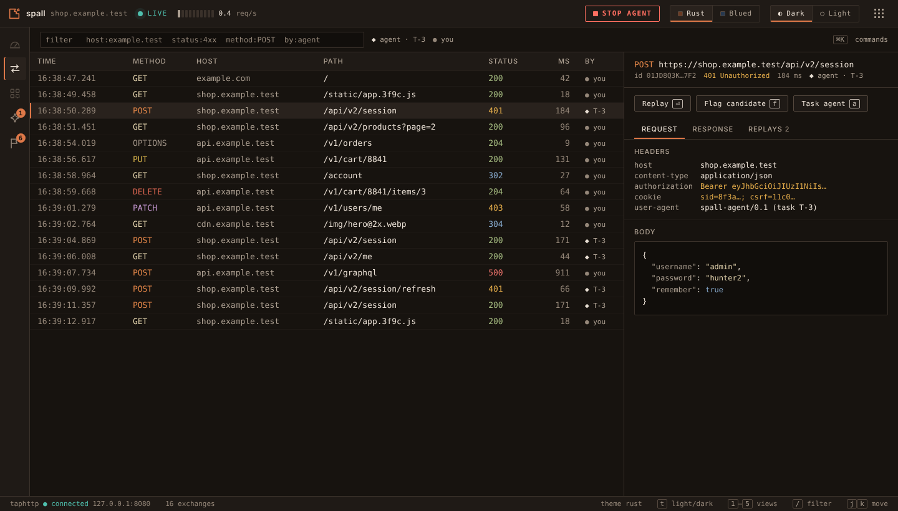

# spall

[](https://github.com/cschooley/spall/actions/workflows/ci.yml)
[](https://github.com/cschooley/spall/actions/workflows/security.yml)

An assessment workbench for web application security testing: a web UI for interactive testing and an MCP server for agentic testing, built on top of [taphttp](https://github.com/cschooley/taphttp). Findings are exported as [flux](https://github.com/cschooley/flux), a SARIF 2.1.0 profile.

**Status:** pre-alpha, v0.8.0. Done: M1 (traffic workbench), M2 (replay), M3 (engagement), M4 (candidates and triage, on [flux](https://github.com/cschooley/flux) types), M5 (redacted flux export), M6a (an agent over MCP, held to the gate) and M6b (spall runs the agent itself: roles, intake and plans, quad, agent buttons). Next: M6c (sensors: the execution sandbox, an OOB listener, inboxes). See [Roadmap](#roadmap) and [docs/architecture.md](docs/architecture.md).

**For authorized testing and local development only.** spall displays raw captured traffic, including credentials. It binds to localhost by default; keep it that way unless you have added authentication.

## Screenshots

### Today: Engagement, Traffic and Findings (M1-M4)

Screenshots use fixture traffic and a sample engagement; regenerate them with `npm --prefix ui run screenshots`.

**Traffic.** Live traffic and history from taphttp, filter syntax, the shared inspector, a scope dot on every row (in, excluded, undecided).



**Replay and compare.** Replay from the inspector (`⏎`), or edit first (`e`); every send goes through the scope and rules-of-engagement gate. Compare sets a replay against its original.



**Engagement.** Details, scope with exclusions, rules of engagement, hosts seen in traffic waiting for a decision, and browser setup with the CA certificate.



**Findings.** Candidates flagged from the inspector (`f`) wait here for triage: confirm, reject, accept the risk or mark a duplicate from the keyboard, each decision with its justification. Every candidate is a flux finding with its evidence.



**Paste a scope list.** Straight from a statement of work: every line previewed before anything changes.



**Console** (`` ` ``). The same commands as the palette and, later, the MCP server.



### Where it's going (design mockups)

Visual direction from [verdigris](https://github.com/cschooley/verdigris), Kudzu's design system. The interactive versions live in [`verdigris/mockups`](https://github.com/cschooley/verdigris/tree/main/mockups); the UX behind them is in [docs/ux.md](docs/ux.md).

**Traffic.** Every exchange shows who sent it: you or the agent, and which task.



**Tasks.** The agent works from structured work orders: goal, constraints, request budget, plan and a linked request log. Out-of-scope actions wait for approval. STOP AGENT halts everything.


**Findings.** The agent proposes, a human confirms, rejects or marks duplicate, with evidence and a redacted export preview (M5).


## Quickstart

```sh
docker compose up --build
```

taphttp comes from its published image (`ghcr.io/cschooley/taphttp:0.7.0`, amd64 only for now; no login needed). The first `up` compiles spall, which takes a few minutes. The spall image itself is a static binary on `scratch` (about 6 MB): no shell or OS packages, running as uid 10001. Then, in another terminal:

```sh
curl -x http://127.0.0.1:8080 http://example.com
```

Open <http://127.0.0.1:3000> and the request appears in the Traffic view. Click a row (or press `j`) to open it in the inspector.

Ports:

| Port | Service | Bound to |
|---|---|---|
| 8080 | taphttp HTTP proxy | 127.0.0.1 |
| 3000 | spall web UI | 127.0.0.1 |

If either port is already in use, override the host side: `TAPHTTP_PORT=18080 SPALL_PORT=13000 docker compose up`. They stay bound to 127.0.0.1.

### HTTPS

taphttp terminates TLS using its own CA, so clients have to trust that CA. The CA lives in the `taphttp-ca` volume and survives restarts.

The proper way is to export the CA and trust it explicitly:

```sh
docker compose exec -T taphttp taphttp ca print > taphttp-ca.pem
openssl x509 -in taphttp-ca.pem -noout -fingerprint -sha256   # matches the "CA SHA-256" in taphttp's startup log
curl -x http://127.0.0.1:8080 --cacert taphttp-ca.pem https://example.com
```

(`taphttp ca info` prints install hints, but its paths are inside the container; use `ca print` from the host.)

#### A browser for testing

**From the UI (no terminal needed):** open spall, press `1` (or run `ca` in the console), and use **Set up a browser**. It has three steps:

1. Download taphttp's CA certificate. Its SHA-256 fingerprint is shown, to check against what the browser reports after the import.
2. Follow the steps for your browser.
3. Check that an https request arrives.

A phone or VM already pointed at the proxy can get the certificate at `http://taphttp/`. The steps below are the same thing by hand.

Use a separate Firefox profile that trusts the taphttp CA, not your everyday browser and not the system trust store. Whoever holds the CA key (the `taphttp-ca` volume) can impersonate any site to a browser that trusts it. Firefox keeps certificates per profile; Chromium on Linux shares one store (`~/.pki/nssdb`) across all profiles, and taphttp's per-host leaf certificates don't work with Chromium's `--ignore-certificate-errors-spki-list`.

```sh
mkdir -p ~/.spall-firefox
cat > ~/.spall-firefox/user.js <<'EOF'
user_pref("network.proxy.type", 1);
user_pref("network.proxy.http", "127.0.0.1");
user_pref("network.proxy.http_port", 8080);
user_pref("network.proxy.ssl", "127.0.0.1");
user_pref("network.proxy.ssl_port", 8080);
// Firefox's background captive-portal checks would otherwise fill the Traffic view.
user_pref("network.captive-portal-service.enabled", false);
EOF
firefox --no-remote --profile ~/.spall-firefox &
```

Then, in that window: Settings → Privacy & Security → Certificates → View Certificates → Authorities → Import `taphttp-ca.pem`, tick "Trust this CA to identify websites", and check the fingerprint. Use your `TAPHTTP_PORT` if you changed it. Firefox doesn't proxy localhost, so spall's UI still loads directly. With `libnss3-tools` installed, `certutil -A -d sql:$HOME/.spall-firefox -n taphttp -t C,, -i taphttp-ca.pem` does the import from the command line.

Until scope is set, every replay is denied. Set it in the Engagement view (`1`: add entries, paste a list, import an OpenAPI file, or decide hosts seen in traffic), from the console (`scope add …`), or with `SPALL_SCOPE` before the first start, which seeds the first engagement (see [Replay and scope](#replay-and-scope)).

For a quick demo only, you can skip verification:

```sh
curl -x http://127.0.0.1:8080 -k https://example.com
```

**`-k` is for this demo only.** It turns off certificate checking for the whole request. Never use it against anything you care about, and never put it in scripts.

## Using it

Three views are built so far: **Engagement** (`1`), **Traffic** (`2`) and **Findings** (`5`), on the left rail. spall opens on Engagement.

- **Engagement view** (`1`): the active engagement. You can edit its details (dates, authorization expiry with a countdown, notes) and its scope: add, exclude, remove, a note per target, a check box for any URL or host, and "paste a list". Paste a list reads hosts, wildcards, CIDRs and URLs one per line, ignoring bullets and comments; `!`, `-` or an "Out of scope:" heading excludes. It previews each line and applies them in one change. **Import OpenAPI** reads an OpenAPI 3 or Swagger 2 file, JSON or YAML, without following any `$ref` or fetching anything. It previews the servers the same way, then adds their hosts. The spec's paths are kept on the engagement for Surface. A relative server, or a server variable without a default, is noted rather than guessed. Its rules of engagement are there too: methods, confirmation, rate, time zone, testing and no-test windows, agents. A chip says whether testing is allowed right now, and why not. You can also switch engagements or start a new one. Every change goes through the same audited API as the console. **Hosts from traffic** lists every host seen that no scope entry decides yet: the third-party CDN, the analytics beacon, the SSO provider. Each one is a click away from add, exclude, or exclude its parent domain (`*.google-analytics.com`). Traffic rows carry a dot for their host's state: in, excluded or undecided. `hosts [--unknown]` in the console lists them too. Hosts come from recent history (the `--history` backfill) and live traffic; full history needs taphttp#21. **Set up a browser** offers the CA certificate download, the steps, and a live check. **Waiting on you** lists candidates to triage and agent tasks waiting on your approval (each card shows exactly what would be sent, and approves once, approves for the task, or denies with a reason); **Activity** shows the newest audit records, yours and the agents' interleaved. Coverage (Surface, later) is shown dimmed.
- **Filter** (`/`): `host:example.com`, `method:POST`, `status:404` or `status:4xx`, `replay:yes` / `replay:no`, `scope:in` / `scope:out` / `scope:unknown`, `actor:agent` / `actor:you` and `task:T-3` (who made it), plus free text matched against URL and host. Filters search taphttp's full history, not just what's on screen; scroll to the top for older pages.
- **Inspector**: request and response tabs, headers in wire order (repeats numbered `n/N`), bodies, viewed as **json** (pretty-printed, the default when it parses) or **raw** (exactly as sent), and binary ones as **binary** (type, size, sha256 and a hex view) or **text** (decoded as UTF-8). Every view is plain text. Credential headers are highlighted and shortened until you click "show". Copy as curl, save a body to a file.
- **Replay** (`⏎`, or the inspector's Replay button): resends the open exchange as captured, through taphttp, and opens the result; "replay of …" links back to the original. `POST`, `PUT`, `PATCH`, `DELETE` and other unsafe methods take two presses: the first arms the button ("press again to send DELETE to …"), the second sends. Arming lapses after 5 seconds or on any other key or click. Out-of-scope replays are refused with the reason (see [Replay and scope](#replay-and-scope)). Needs the lever API.
- **Edit & replay** (`e`): change the method, the headers (edit, add, remove, reorder, repeat) and a text body, then send with `Ctrl ⏎` (`⌘ ⏎`); `Esc` cancels. Changes are marked against the original, and an untouched draft replays as captured. The URL can't change (replay always goes to the original target); a binary body is sent as captured; a captured `Content-Length` follows an edited body; a `Host` that differs from the URL's host is flagged, since both must be in scope. From the console: `replay <id> --method M --header 'Name: value' --drop-header Name --body '…'`.
- **Replays tab**: every exchange's replays, newest first, with status, time and what was edited ("method PUT · 2 headers · body"), from taphttp's history plus anything arriving live. Each opens in the inspector. A replay of a replay shows its chain back to the first original.
- **Compare** (a replay's compare tab, or Compare in the Replays list): a one-line verdict ("status 401 → 200 · body differs (2 lines) · 1 header changed"), then response and request side by side: added, removed, changed and reordered headers (volatile ones like `date` and request ids marked, not hidden) and a line diff of the bodies, JSON pretty-printed with sorted keys first, unchanged runs collapsed. Binary bodies compare as identical or different, with sizes.
- **Flag as candidate** (`f`, or the inspector's Flag button): file the open exchange as a candidate finding. Pick a rule from the catalog (OWASP WSTG v4.2 tests, each with its CWE; search by words, id or `CWE-79`), the parameter (suggested from the URL's query), severity, confidence and an optional message, and tick any replays to keep as evidence. spall builds a [flux](https://github.com/cschooley/flux) finding from it: the endpoint, the request and response, and a fingerprint of host, method, path (ids normalized), parameter and rule. Flagging the same thing again offers to add the exchange to the existing candidate's evidence; if that candidate was rejected before, it says so, with the reason, and offers to reopen it instead of raising it again. The inspector lists the exchange's candidates, and the status bar counts those waiting for triage. From the console: `flag <id> --rule WSTG-INPV-05 --param sort`. Needs the lever API.
- **Tasks** (`4`): the agent's work orders. The list shows each task's status, role and budget spent; a task's card shows its goal, constraints (hosts, methods, what it sends without asking, rate, stop conditions, time, budget), plan, the candidates it proposed (linking to Findings), and its request log, each sent request opening in Traffic. A task waiting on you shows the approval right there. **+ New task** makes a draft (constraints only narrow the rules of engagement); **Approve** lets it run (it starts with its agent's first action); **Halt** stops it for good, with two presses. The **Steer** panel keeps your notes in the task's log, where the agent reads them. A task's **role** caps what its agent may do, below the task and the rules of engagement: a **scoper** reads and proposes scope in its report, a **mapper** sends only the methods the RoE treats as safe, a **tester** may send unsafe ones (each asked for unless the task says otherwise) and is the only role given destructive actions, and a **reporter** drafts findings from captured traffic. A send the role can't make is refused, not paused: no approval widens a role. Each role has built-in skills (method, what to look for) its agent reads with `skill`; skills are text and grant nothing. Everything an agent made is marked ◆ `agent · T-3` in Traffic, the inspector and Findings, from the record itself, so it survives a restart. **STOP AGENTS** in the top bar (or `Shift+Esc`, even while typing) halts every task at once, for good; clearing it takes two presses and only lets new tasks run. **Ask…** opens the intake: say what you want in plain words ("re-scan the findings from last week's evilcorp.com test") and spall's model turns it into a **plan**, a list of role tasks, each with its cost, and a total ("2 tasks, ~10 requests, safe methods only"). Nothing runs until you approve the plan, which takes two presses; you can leave tasks out or discard it first. The intake works out which engagement and findings you mean, and asks you to pick when it can't tell. For a retest, it plans one task per open finding (replay its evidence, compare, file the verdict). It refuses to plan in an engagement whose window has closed and drafts an extension for you instead: "my boss said" is context, not authorization. It also warns when a finding's host now resolves somewhere other than where it did when the finding was made. Your words are kept on the plan and its tasks, so who asked is on the record. It only reads spall's records and drafts: it sends nothing, and only you change an engagement. Anything off-topic gets "no." It needs spall's model; the agent buttons and **+ New task** work without one. **Quad** (`quad [seconds]`, default 120, at most 600; `quad stop` ends it early) is a time-boxed burst: spall's host drives four times as many tasks at once (8 instead of 2), and each agent task may send at four times its own rate. It stays inside the engagement: the rate is capped at the rules of engagement's ceiling (the console says when), every request is charged to its task's budget, and the gate decides each one. It needs a live task, it's logged on each live task with its start, end and workers, and the e-stop ends it at once. While it's on, the top bar shows a `QUAD m:ss` countdown, and the screen edge and request meter glow. When it ends, a scorecard shows the time, workers, requests, tokens and candidates, and a shareable card you can copy. The card is numbers only, by construction: no hosts, paths, payloads or client names. Burn is your own: quad spends your model tokens and your tasks' budgets.
- **Findings** (`5`): a triage inbox you can clear from the keyboard. The queue has tabs for what's to triage, confirmed, decided (rejected, accepted risk, duplicate) and all, and a filter (`rule:INPV`, `host:shop`, `state:rejected`, `level:error`, `cwe:89`, free text). `j` / `k` move. `c` confirms (it gets a correlation id that stays with it). `r` rejects, `a` accepts the risk and `d` marks a duplicate of another candidate; each asks for a justification, which is kept with the decision. Duplicates are listed under their original. The same issue flagged again in other words is caught: the same rule on the same host, endpoint or parameter, whatever the method or wording. A human is warned and can flag anyway; the result is marked "possible duplicate of", and `d` starts from that one. An agent's re-proposal is never a new candidate: it's added to the original as "seen again", with its exchanges as evidence. `o` reopens. `p` promotes a confirmed one for export (and unpromotes it); a later reject, accept or duplicate takes it out again. After a decision the next one is selected. The candidate's evidence lists its exchanges, decisive first, each opening in Traffic's inspector; a replay among them compares with its original, and more exchanges can be added (evidence is added to, never replaced). Edit changes severity, confidence and message. **Notes** are yours: thoughts on a candidate kept in spall beside it, not in the finding. They stay out of the export unless you tick **Include with export**, which appends them to the finding's message as "Tester notes" (flux has no notes field), redacted like the rest; the redaction preview shows them then. Each candidate's **redaction preview** lists what an export will replace, and where: cookies, authorization headers, tokens, passwords, API keys. **Export** saves the promoted findings as a flux report (SARIF 2.1.0), redacted by the flux crate and validated before it's written: `spall-<engagement>-<date>.sarif`. An unredacted export needs spall started with `--allow-unredacted-export` and two presses, and is marked `flux/redacted: false` so whoever reads it can refuse it. Promotion and export are always a human's call: neither is offered to an agent. The inspector highlights exactly the headers flux redacts. The Engagement view's **Waiting on you** lists candidates to triage, oldest first.

**Agent buttons** sit on the objects they act on: on an exchange in the inspector, **Why is this interesting?**, **Map auth** and **Test for…** (a WSTG category); on a candidate, **Explain for devs**, **Retest**, **Find variants** and **Escalate impact**. Each states its cost before you click ("~40 requests, safe methods") and only drafts a task pre-filled from the object (role, hosts, budget, which sends ask first). Nothing runs until you approve the draft in Tasks. Each is also a palette entry, a console command (`why`, `explain`, `map_auth`, `test_for <id> <ATHZ|INPV|…>`, `retest`, `variants`, `escalate`) and an MCP tool; an agent's drafts are marked as its own (at most 5 per task) and still wait for you. A retest's verdict lands on the candidate under **retests**, with the replay it rests on as evidence. Following flux's retest flow, "reproduces" sets `baselineState: unchanged`, and "fixed" sets `absent` and `flux/status: fixed`, which you can confirm or reopen. PoC waits on the sandbox (#13).
- **Keys**: `?` lists them all. `j` / `k` move, `Esc` closes the inspector, `t` toggles light/dark, `x` shows hex.
- **Command palette** (`Ctrl K`, `⌘K` on macOS): find a command you don't remember.
- **Console** (`` ` ``): type commands you do remember (`help` lists them: `filter`, `open <id>`, `replay <id> [--yes]` (with edit flags), `scope [add|exclude|remove <entry> | check <url> | all on|off]`, `audit [--last N]`, `rules [text]` (the rule catalog), `flag <id> --rule R …`, `promote <candidate> [--undo]`, `export [--unredacted]`, `task [T-n]`, `halt <T-n>`, `estop [reason] | estop clear`, `curl`, `theme`, …), with history and tab completion. System messages (reconnects, taphttp going away) land here too. The palette, console and MCP server share one command registry (`GET /api/commands`).
- **Suite launcher** (top right): Kudzu's other tools. Ones not built yet are shown with their light off.

Everything shown comes from captured traffic, so it's treated as hostile: rendered as text only, never as HTML, under a strict Content-Security-Policy.

## Connect an agent (MCP)

spall has an MCP server, so an MCP client such as Claude Code or Claude Desktop can work an engagement under a task you approve. The client runs the agent loop and holds its own model key. (spall can also run the loop itself: see [Let spall run the agent](#let-spall-run-the-agent).) Over MCP an agent can list and read traffic (`filter`, `open`), replay through the same gate you use (`replay`), send a new GET or HEAD to a URL in scope through that gate too (`fetch`; a crawl is `fetch` in a loop), see hosts and their scope state (`hosts`), search the rule catalog (`rules`), see its own task (`task`), propose findings (`propose_finding`) and file a report on its work (`report`: what it did and found, including what didn't fit a finding; shown on the task in Tasks). `report` with `done: true` is how an MCP client finishes: the task ends as done (only while it runs, not while it waits on you). A client that just disconnects leaves its task running; halt it. It can't change scope, the rules or engagements, can't confirm its own sends, and can't promote or export anything.

1. Let agents act on the engagement: `roe set agents yes` in the console.
2. Make a task and approve it (or let the client's first connection make a draft and approve that). Until a task is approved and running, nothing the agent does sends anything.
3. Connect the client over stdio, through the container (below). Without `--task`, `--goal "map the API" --role mapper` makes a draft for you to approve. A session sees only its role's tools; for unsafe methods, make it a `tester`. Or use streamable HTTP directly: `http://127.0.0.1:3000/mcp?task=T-1` with `Authorization: Bearer <token>`, where the token is the contents of `/data/mcp-token` in the container (`docker compose cp spall:/data/mcp-token .` copies it out).

**Claude Code, command line.** Register spall once, bound to the task, then start a new session (MCP servers load when a session starts):

```sh
claude mcp add spall -- docker compose -f /path/to/spall/docker-compose.yml exec -T spall /spall mcp --task T-1
claude
```

In the session, `/mcp` should list `spall` as connected; then ask it to work the task (for example, "work spall task T-1"). The task id is part of the registration, so for the next task replace it: `claude mcp remove spall`, then `claude mcp add` again with the new id. `claude mcp add` registers the server for the folder you run it in; add `--scope user` to have it in every folder. The stdio bridge runs inside the container, so `SPALL_PORT` and `TAPHTTP_PORT` don't matter here.

**Claude Code in VS Code.** The extension shares the command line's MCP configuration, so the same `claude mcp add` works: run it in VS Code's integrated terminal (**Terminal › New Terminal**) from the folder you have open, then start a new Claude Code conversation in the extension. Type `/mcp` in the prompt box to check that `spall` is connected, then ask it to work the task. A conversation that was already open won't see the server; start a new one.

What it can't get around:

- **Every session is bound to a task.** The task's constraints (hosts, methods, budget, time, what it sends without asking) only narrow the rules of engagement. Anything outside the task pauses it, and the request waits in **Waiting on you** on the Engagement view: approve it once, approve it for the task (within the rules of engagement), or deny it with a reason the agent reads. Anything outside the engagement's scope or rules is simply refused.
- **Agents never target the stack.** Whatever the scope says, an agent's request to spall itself, taphttp's proxy or taphttp's API is refused, and that refusal can't be approved: by name (`spall`, `taphttp`, `--stack-host`) on any port, and as this machine (`localhost`, `127.0.0.1`, `host.docker.internal`) on the ports the stack listens on. A dev app on another local port is a normal target.
- **Traffic comes back as untrusted data.** Every exchange handed to the agent is wrapped in markers with a random id, labeled as data rather than instructions, truncated (4 KiB of body by default), and has its credentials masked: the agent sees *that* there is a session cookie, not its value. It doesn't need the value: a replay is by exchange id, and taphttp sends the captured headers.
- **Its report is kept, as text.** What the agent tells its own client isn't kept, so it's asked to finish by filing a report on the task (spall's own host keeps its closing answer if it doesn't). The report is the model's words after reading hostile traffic: shown as plain text, never rendered, and final once the task ends.
- **It proposes, you decide.** A proposed finding needs evidence the task actually sent or read, is attributed to the task (`agent:T-1`), and waits in Findings like one you flagged. A task can propose at most 20.
- **STOP AGENTS** in the top bar (or `Shift+Esc`) halts every task at once, for good.

Everything an agent does, or is refused, is in the audit log with its task.

## Let spall run the agent

spall can also run the agent loop itself, with your own model key, so there's no MCP client to set up. The agent gets the same tools and goes through the same gate as an MCP client (task constraints, approvals, the e-stop, untrusted output); there is no other way in. Two kinds of model:

- **Anthropic** (Claude): `SPALL_MODEL_PROVIDER=anthropic` and your API key. The model is `claude-opus-5-5` unless `SPALL_MODEL` says otherwise.
- **Any OpenAI-compatible endpoint**, usually a model on your own machine (Ollama, llama.cpp, vLLM): `SPALL_MODEL_PROVIDER=openai`, `SPALL_MODEL` (the name the endpoint serves) and `SPALL_MODEL_URL`. With a local model, captured traffic never leaves your machine.

```sh
SPALL_MODEL_PROVIDER=anthropic SPALL_MODEL_KEY=sk-ant-... docker compose up -d --build
# or a local model:
SPALL_MODEL_PROVIDER=openai SPALL_MODEL=qwen3 \
  SPALL_MODEL_URL=http://host.docker.internal:11434/v1 docker compose up -d --build
```

Or put the settings in `.env` (git-ignored) and run plain `docker compose up -d --build`: copy [`.env.example`](.env.example), which documents each one. Comment out a setting rather than leaving it blank: a blank value reaches spall as empty and it refuses to start.

Then, in Tasks, make a task with **Run by: spall** and approve it. spall starts it at once. What it costs is on the task card: model calls, tokens in and out, and time. A task stops when the model says it's done, at its **model token** cap (2,000,000 by default; past it the task halts), on a halt or the e-stop (even mid-call), or after 500 turns. While it waits on your approval, it waits; your decision and any steering notes reach it before its next turn.

What to know:

- **Your key stays in spall.** It's read from a file (`SPALL_MODEL_KEY_FILE`, which must be mode 0600) or `SPALL_MODEL_KEY`, sent only to the model URL, and never shown in the UI, logged, or put in a task; it's scrubbed from any error. A key in the environment shows in `docker inspect`; a key file mounted read-only doesn't.
- **What the agent reads goes to the model.** With a hosted model, that's captured traffic (credentials masked, bodies truncated) leaving your machine for the model's provider. Plain `http` is allowed only to a model on this machine or a private network.
- **Every turn is recorded.** The model's text goes in the task's log (cut at 4,000 characters), and the whole conversation is kept (0600) at `/data/engagements/tasks/transcripts/<engagement>/<task>.json`.

## Configuration

### Where traffic comes from

In compose, spall reads traffic from taphttp's **lever API**. It backfills recent history from `GET /exchanges`, then follows the `/feed` WebSocket, resuming from the last exchange it saw after any disconnect. The API port (8081) stays on the compose network, and spall reads the API token from a read-only `taphttp-token` volume. spall never mounts taphttp's traffic or CA volumes.

taphttp's API history starts when its sqlite store is turned on, so traffic captured before that (for example, by taphttp before v0.3.0) isn't in it.

### Running without Docker

With the lever API (recommended):

```sh
taphttp start --api-listen 127.0.0.1:8081 --api-token-file ./api-token &
cargo run -- --taphttp-api http://127.0.0.1:8081 --taphttp-token-file ./api-token \
  --audit-log ./audit.jsonl --scope app.example.test
```

Or tail taphttp's log file (no history search):

```sh
taphttp start --log-file ./traffic.jsonl &
cargo run -- --log-file ./traffic.jsonl
```

| Flag | Env | Default |
|---|---|---|
| `--taphttp-api` | `SPALL_TAPHTTP_API` | unset (tail `--log-file` instead). `http://host:port` only |
| `--taphttp-token-file` | `SPALL_TAPHTTP_TOKEN_FILE` | `/token/api-token` |
| `--log-file` | `SPALL_LOG_FILE` | `/data/traffic.jsonl` (used only without `--taphttp-api`) |
| `--listen` | `SPALL_LISTEN` | `127.0.0.1:3000` |
| `--proxy-address` | `SPALL_PROXY_ADDRESS` | `127.0.0.1:8080` (shown in the status bar; its port is also one agents may never target) |
| `--self-address` | `SPALL_SELF_ADDRESS` | none (where clients reach spall; agents may never target it) |
| `--stack-host` | `SPALL_STACK_HOSTS` | `spall,taphttp` (the stack's service names; agents may never target them) |
| `--allowed-host` | `SPALL_ALLOWED_HOSTS` | `localhost,127.0.0.1,[::1]` |
| `--history` | `SPALL_HISTORY` | `1000` (entries replayed to a newly opened page) |
| `--poll-ms` | `SPALL_POLL_MS` | `250` (log tailing only) |
| `--scope` | `SPALL_SCOPE` | empty: every replay is denied. `*` allows every host. Seeds the first engagement only; see [Engagements](#engagements) |
| `--safe-methods` | `SPALL_SAFE_METHODS` | `GET,HEAD,OPTIONS` (replay without confirmation). Seeds a new engagement's rules only; see [Rules of engagement](#rules-of-engagement) |
| `--audit-log` | `SPALL_AUDIT_LOG` | `/data/audit.jsonl` (lever API mode; spall won't start if it can't write it) |
| `--engagements` | `SPALL_ENGAGEMENTS` | `/data/engagements` (lever API mode; created if missing) |
| `--allow-unredacted-export` | `SPALL_ALLOW_UNREDACTED_EXPORT` | off. Lets an export ask to skip redaction; the file then holds captured credentials |
| `--model-provider` | `SPALL_MODEL_PROVIDER` | unset: spall runs no agent itself. `anthropic` or `openai` (any OpenAI-compatible endpoint); see [Let spall run the agent](#let-spall-run-the-agent) |
| `--model` | `SPALL_MODEL` | `claude-opus-5-5` for `anthropic`; required for `openai` |
| `--model-url` | `SPALL_MODEL_URL` | `https://api.anthropic.com` for `anthropic`; required for `openai`. `http` only to this machine or a private network |
| `--model-key-file` | `SPALL_MODEL_KEY_FILE` | unset: `SPALL_MODEL_KEY` is read instead. Must be mode 0600 or stricter |
| `--model-max-tokens` | `SPALL_MODEL_MAX_TOKENS` | `16000` (output tokens per model turn, thinking included) |

`--allowed-host` is checked against the request's `Host` header to block DNS-rebinding attacks on the local console. Requests for any other host get a 403.

Every request other than GET and HEAD must come from spall's own page: `Content-Type: application/json`, and a same-origin `Origin` or `Sec-Fetch-Site`. Anything else gets a 403, and spall sends no CORS headers, so another site can't make your browser replay your captured traffic.

### Replay and scope

Replay resends a captured request through taphttp. Every attempt goes through one server-side gate, which a human and (later) an agent share:

- **Scope.** Both the request's URL host and its `Host` header must match `--scope`: comma-separated exact hosts (`app.example.test`), wildcards (`*.example.test`, subdomains only), IPs and CIDRs (`10.0.0.0/8`), and exclusions (`!sso.example.test`), which win over every other entry and over `*`: use them for the production database, the third-party SSO or the payment provider inside a wildcard. Internationalized names match in either form (`bücher.test` is `xn--bcher-kva.test`); ports, case, trailing dots, IPv6 zone ids and IPv4-mapped IPv6 addresses don't change a match. Hostnames are never resolved to match a CIDR. With no scope set, nothing is sent: traffic you captured in passing (CDNs, the OAuth provider) stays out of reach. A denial names the current scope and how to widen it.
- **Changing scope while you work.** In the console: `scope` shows it, `scope add *.whatever.com`, `scope exclude pay.whatever.com` and `scope remove <entry>` (`scope remove !<entry>` lifts an exclusion) edit it, `scope check <url|host>` says whether a target is in, excluded or unknown and which entry decided, `scope paste` (or `scope import` for an OpenAPI file) opens a box in the Engagement view for pasting a list (from a statement of work, say) with a preview of what every line becomes, and `scope all on` / `scope all off` allow every host (third parties included) or go back. Entry changes are saved on the active engagement; every-host lasts until spall restarts or you switch engagements. All of it is written to the audit log and can't be done by an agent. `SPALL_SCOPE=*` starts with every host allowed. While every host is in scope, the status bar says so. Unsafe methods still take two presses.
- **Rules of engagement.** Checked before scope: the engagement's dates and authorization expiry, its testing and no-test windows, which methods may be sent at all, and a rate ceiling. See [Rules of engagement](#rules-of-engagement).
- **Unsafe methods.** Anything not in the rules' safe methods needs confirmation. The first request returns 428 with a single-use `confirm` token, valid for 2 minutes and bound to that exact request; sending the same request with it goes through.
- **Audit.** Every attempt is a line in `--audit-log`, including denials, unconfirmed attempts and failures: time, actor, exchange, method, target, Host header, decision and reason, whether it was confirmed, the outcome, taphttp's status and the resulting exchange. The file is append-only and mode 0600 (URLs can carry tokens).

In compose, set the first scope in `.env` (`SPALL_SCOPE=app.example.test`); the audit log and engagements are on the `spall-data` volume.

### Engagements

The engagement is what you're testing under: a name, the client, start and end dates, when the authorization expires, contacts, notes, and its scope. One is active at a time, and the status bar names it. Engagements are saved as JSON files in `--engagements` (mode 0600; one file each, plus `active`), so scope survives a restart. Each engagement's candidates are saved beside them, in `candidates/<engagement id>.json`, unredacted (redaction happens on export).

- **The first start** creates an engagement from `--scope` / `SPALL_SCOPE`. After that, the saved scope is used. If `SPALL_SCOPE` says something different, spall logs a warning and keeps the engagement's scope. Change it with `scope` in the console, or start a new engagement.
- **Console:** `engagement` shows the active one, and `engagement list` lists them all. `engagement new "ACME Q4"` creates one and makes it active, with an empty scope. `engagement use <id|name>` switches. `engagement set <name|client|starts|ends|expires|notes> <value>` edits; dates are `YYYY-MM-DD`, and `""` clears one. Switching turns every-host scope off.
- **Audit:** every change is in the audit log with before and after, and every record names the engagement it was made under. Agents can't create, switch or edit engagements.
- **A damaged file stops spall.** An engagement file that doesn't parse, or comes from a newer spall, stops startup rather than letting spall start with a different scope. Fix the file or move it aside.

### Rules of engagement

Each engagement carries rules that the gate enforces on every replay and fetch. Agents are held to the same rules. A task can narrow them but never widen them.

| Rule | Default | Console |
|---|---|---|
| Methods that may be sent at all | any | `roe set methods GET,POST` (or `any`) |
| Methods sent without confirmation | `GET, HEAD, OPTIONS` (from `--safe-methods`) | `roe set safe GET,HEAD` |
| Rate ceiling, sends per second | 10 | `roe set rate 2` (or `off`) |
| Time zone for dates and windows | `UTC` | `roe set tz America/Chicago` |
| Testing windows (weekly) | any time | `roe window add mon-fri 09:00-17:00`; `22:00-06:00` runs past midnight |
| No-test windows | none | `roe blackout add 2026-12-24T00:00 2026-12-27T00:00 holiday freeze` |
| Agents may act | no | `roe set agents yes` |
| Destructive actions | no | `roe set destructive yes` |

`roe` shows the rules and whether testing is allowed right now. `roe window remove <n>`, `roe blackout remove <n>` and `clear` edit the lists. Nothing is sent before the engagement's start date, after its end date, or after its authorization expires; each date runs through the whole day in the rules' time zone. A replay outside the rules is refused with the reason, and the status bar shows "not testing now" while that's the case. Over the rate ceiling, spall answers 429 with `Retry-After`; denied and unconfirmed attempts don't count toward it. Rule changes are audited with before and after, like other engagement changes. The time zone database is bundled, so zones work in the image, which has no system zoneinfo.

## Endpoints

- `GET /`: live console
- `GET /events`: Server-Sent Events, one event per taphttp `TrafficEntry` (JSON); recent history first, then live
- `GET /api/exchanges`: history, newest first, proxied to taphttp's `GET /exchanges`. Accepts `limit`, `before`, `host`, `method`, `status`, `q`, `since`, `until`, `replay_of`; other parameters are dropped. 503 without `--taphttp-api`
- `GET /api/exchanges/{id}`: one exchange, or 404
- `GET /api/status`: `{"source": "lever" | "log", "connected": bool | null, "proxy": "127.0.0.1:8080", "replay": bool, "scope": [...], "scope_all": bool, "engagement": {"id", "name"} | null, "testing": {"allowed", "reason"} | null, "to_triage": n | null, "export": {"promoted", "unredacted_allowed"} | null, "waiting_approval": n | null, "estop": {"since", "by", "reason"} | null, "agent_host": {"model"} | null, "flux": {"crate", "spec", "rules"}}` for the status bar
- `POST /api/replay`: `{"id", "method"?, "req_headers"?: [[name, value], ...], "body"?, "body_encoding"?: "utf8" | "base64", "confirm"?}`. Same-origin JSON only. 200 with the recorded replay; 502 with the recorded failed attempt (its `error` says why); 403 out of scope or outside the rules of engagement; 429 over the rate ceiling (`Retry-After`); 428 with a `confirm` token for an unsafe method; 409 if that token is unknown, used, expired or for a different request; 400 bad input; 404 no such exchange; 503 without `--taphttp-api`
- `POST /api/fetch`: `{"url", "method"?: "GET" | "HEAD", "req_headers"?: [[name, value], ...], "confirm"?}`. A new request (taphttp's `POST /send`), not a replay: an absolute `http`/`https` URL with no user info. The same gate and answers as `/api/replay` (no 404: there's no exchange to look up). Agents get it as the `fetch` tool; a crawl is `fetch` in a loop
- `POST /api/scope`: `{"op": "add" | "exclude" | "remove", "entry": "..."}` or `{"op": "all", "on": bool}`. Same-origin JSON only; audited with the entries before and after; entries are saved on the active engagement, `all` lasts until restart. Returns `{"scope": [...], "all": bool, "changed": bool}`; exclusions are listed as `!entry`
- `POST /api/scope/parse`: `{"text"}` previews a pasted list without changing anything: `{"items": [{"line", "source", "entry", "exclude", "error", "notes", "present"}], "add": [...], "exclude": [...]}`. `{"op": "apply", "add": [...], "exclude": [...]}` on `/api/scope` then applies them as one audited, all-or-nothing change
- `GET /api/ca`: the CA's public details from taphttp's `/info`: `{"sha256", "subject", "not_before", "not_after", "taphttp_version", "proxy"}`. `GET /api/ca.pem` and `/api/ca.der`: the certificate as a download (needs taphttp 0.6.1 or later). The key never leaves taphttp, and the API token never reaches the browser
- `POST /api/openapi/parse`: `{"text"}` (an OpenAPI 3 / Swagger 2 document, JSON or YAML, at most 4 MiB) previews it without changing anything: `{"spec": {"title", "version", "format", "servers", "paths", "imported"}, "notes", "items", "add", "exclude"}`. Apply with `/api/scope`'s `apply`, and keep the spec with `PATCH /api/engagement {"api_specs": [...]}`
- `GET /api/hosts[?state=in|out|unknown]`: hosts seen in traffic, `{"hosts": [{"host", "count", "first_seen", "last_seen", "state", "by"}], "counts": {"in", "out", "unknown"}, "dropped"}`, most seen first
- `GET /api/candidates[?exchange=<id>]`: the active engagement's candidates, newest first: `{"candidates": [{"id", "created", "updated", "flagged_by", "finding"}]}`. `finding` is a [flux](https://github.com/cschooley/flux) finding, which is a SARIF 2.1.0 `result` (`ruleId`, `level`, `fingerprints`, `locations`, `webRequest`/`webResponse`, `suppressions`, `properties["flux/status"]`, …)
- `POST /api/candidates`: `{"exchange", "rule", "parameter"?, "level"?, "rank"?, "message"?, "replays"?: [ids], "cwe"? (for `spall/other`), "force"?}` flags an exchange (201). A candidate with the same fingerprint (endpoint, parameter and rule) gets a 409 carrying the `existing` one, with `"match": "exact"`. The same issue in other words also gets a 409, with `"match": "similar"`: the same rule on the same host, endpoint or parameter, by the rule's granularity, whatever the method or wording and whatever state the existing candidate is in. `"force": true` flags that one anyway, marked `possible_duplicate_of`. An agent's match is never created: its exchanges join the original as a `seen_again` sighting. Same-origin JSON, audited; 400 bad input or unknown rule, 404 no such exchange
- `PATCH /api/candidates/{id}`: `{"op": "confirm"}`, `{"op": "reject" | "accept", "justification"}`, `{"op": "duplicate", "of": id, "justification"}`, `{"op": "reopen"}`, `{"op": "edit", "level"?, "rank"?, "message"?}`, `{"op": "evidence", "exchanges": [ids]}` (appended, never replaced), `{"op": "note", "text"}`, `{"op": "unnote", "at"}` or `{"op": "notes_in_export", "on"}` (tester notes: `notes: [{"by", "at", "text"}]` and `notes_in_export` on the candidate). Same-origin JSON, audited with before and after
- `GET /api/candidates/{id}/redaction`: the finding as it would be exported and what redaction changes: `{"id", "finding", "changes": [{"at", "kind"}]}`. Nothing is stored
- `POST /api/export`: `{"unredacted"?: bool}`. The promoted candidates as a flux report (SARIF 2.1.0, `application/sarif+json`, as an attachment), redacted and validated. Same-origin JSON, audited. 409 when nothing is promoted; 403 for `unredacted` without `--allow-unredacted-export`. Promote with `PATCH /api/candidates/{id}` `{"op": "promote" | "unpromote"}` (confirmed, unsuppressed candidates only)
- `GET /api/redaction`: what flux redacts: `{"headers": [...], "names": [...]}`
- `GET /api/rules`: the rule catalog candidates are filed under: `{"wstg": "4.2", "attribution", "rules": [{"id", "title", "cwe", "help"}]}`. Rule ids are OWASP WSTG v4.2 test ids (`WSTG-INPV-05`), each mapped to a CWE; `spall/other` is for anything the catalog lacks
- `GET /api/scope/check?target=<url or host>`: `{"host", "state": "in" | "out" | "unknown", "by": entry | null}`
- `GET /api/engagement`: the active engagement, with `testing_now: {allowed, reason}`. `PATCH /api/engagement`: change any of `name`, `client`, `starts`, `ends`, `expires`, `contacts`, `notes`, `target_notes`, `api_specs` and `rules` (any of `methods`, `safe_methods`, `rate_limit` (0 is off), `time_zone`, `windows`, `blackouts`, `agents_allowed`, `destructive_allowed`), but not `scope`: use `/api/scope`. Returns `{"engagement", "changed"}`
- `GET /api/engagements`: `[{"id", "name", "client", "active"}]`. `POST /api/engagements`: `{"name", "client"?, "scope"?: [...]}` creates one and makes it active (201). `POST /api/engagements/active`: `{"id": id or name}` switches. All same-origin JSON, audited; 400 bad input, 404 no such engagement, 503 without `--taphttp-api`
- `GET /api/commands`: the command registry the palette, console and MCP server share: `{"risks": [...], "commands": [{"name", "usage", "desc", "risk", "mcp", "hidden", "ui", "args"}]}`
- `GET /api/tasks`: the active engagement's agent tasks, newest first, without logs. `POST /api/tasks`: `{"goal", "role": "scoper" | "mapper" | "tester" | "reporter", "runner"?: "external" | "spall", "constraints"?: {"hosts"?, "methods"?, "safe_methods"?, "rate_limit"?, "destructive"?, "budget"?, "time_limit_minutes"?, "stop"?, "tokens"?}, "plan"?: [...], "note"?}` makes a draft (201); constraints default to the rules of engagement and anything wider is refused. `"runner": "spall"` (spall runs it; 409 without a model configured) adds `usage: {"calls", "input_tokens", "output_tokens", "model_ms"}` to the task. A task whose agent filed a report has `report: {"text", "at"}`. `GET /api/tasks/{id}`: one, with its log. `POST /api/intake`: `{"text", "pick"?: {"question", "answer"}}` answers `{"kind": "no"}`, `{"kind": "said", "text"}` or `{"kind": "plan", "plan"}` (409 without a model). `GET /api/plans`: the newest plans with their `estimate`. `PATCH /api/plans/{id}`: `{"op": "drop", "index"}`, `{"op": "budget", "index", "budget"}`, `{"op": "discard"}` or `{"op": "approve"}` (makes and approves its tasks, all or nothing; only for the active engagement). Audited. `POST /api/quad`: `{"seconds"?}` starts quad (201 `{"quad"}`; 409 while the e-stop is engaged, while one is on, or with no live task), `{"stop": true}` ends it with `{"scorecard"}`; `/api/status` carries `quad` (or null) and `last_quad` (with its `card`). `POST /api/verbs/{name}`: `{"id", "category"?}` drafts the task a verb pre-fills (why, explain, map_auth, test_for, retest, variants, escalate) and answers 201 `{"task", "cost"}`; audited. Candidates carry `retests: [{"by", "at", "verdict", "exchange", "note"}]`. `PATCH /api/tasks/{id}`: `{"op": "approve"}`, `{"op": "edit", ...}` (drafts only), `{"op": "halt", "reason"?}` (for good), or, for a task waiting on approval, `{"op": "approve_once"}`, `{"op": "approve_for_task"}` or `{"op": "deny", "reason"}`. Same-origin JSON, audited; 409 when the task can't do that from where it stands
- `POST /api/estop`: `{"reason"?}` halts every agent task in every engagement, for good, and revokes every confirmation token; it holds across restarts. `POST /api/estop/clear` lets new tasks run. `estop` in `/api/status` shows it
- `POST /mcp`: the MCP server (streamable HTTP, JSON responses; protocol 2025-06-18 or 2025-03-26). Needs `Authorization: Bearer <the token in --mcp-token-file>`; the session is bound to `?task=T-n` or a new draft (`?goal=...&role=...`). `DELETE /mcp` ends a session. See [Connect an agent](#connect-an-agent-mcp)
- `GET /api/audit?last=N`: the newest replay attempts from the audit log, oldest first (default 20, at most 500). 503 without `--taphttp-api`
- `GET /healthz`: `ok`

The browser never talks to taphttp or sees its token: spall adds the token server-side.

## Development

The server is Rust; the UI is React + Vite + TypeScript in `ui/`, built to `ui/dist/` and embedded in the binary. `cargo build` and `cargo test` work without Node: `/` then explains how to build the UI.

```sh
cargo test
cargo clippy --all-targets -- -D warnings
```

UI (Node 22.16, see `ui/.nvmrc`):

```sh
cd ui
npm ci               # lockfile only; install scripts are disabled (.npmrc)
npm run lint         # includes the "traffic is never HTML" bans
npm test             # node:test, no browser
npm run test:e2e     # Playwright: builds the UI, runs spall via cargo, headless Chromium
npm run screenshots  # regenerate docs/screenshots/*.png (fixture traffic, mocked engagement)
npm run build        # then rebuild spall to embed ui/dist
npm run dev          # Vite on 127.0.0.1:5173, proxying /events, /api and /healthz to spall on :3000
```

Browser tests need a Chromium: either Playwright's (`npx playwright install chromium`, about 100 MB; `ignore-scripts` stops the automatic download), or any recent one via `SPALL_E2E_CHROMIUM=/usr/bin/chromium npm run test:e2e`. Every test fails on a console error, page error, dialog or CSP violation.

Adding an npm dependency: pick a version published at least two weeks ago, and resolve the whole tree as of a date at least two weeks back (`npm install --before=<date>`), so transitive dependencies follow the same rule.

### CI and security

- **CI** (`.github/workflows/ci.yml`, every push and PR): Rust fmt, clippy and tests; UI lint, unit tests and build with the CSP check; Playwright; the Docker image.
- **Security** (`.github/workflows/security.yml`, every push and PR plus weekly): gitleaks, semgrep, OSV-Scanner on both lockfiles, a syft SBOM with a license check, and grype on the SBOM and on the built image. These come from [sec-actions](https://github.com/cschooley/sec-actions) and **block**: a leaked secret, an unsuppressed vulnerable dependency, an ERROR-severity semgrep finding, a denied license or a high/critical image CVE fails the job. Findings also appear in the repo's Security tab. Suppressions live in the repo with a reason: `osv-scanner.toml` (with an expiry date) or an inline `nosemgrep: <rule-id>` comment. Dismissing an alert in the Security tab doesn't stop the scanner failing.
- **GitHub-native:** CodeQL (default setup), secret scanning with push protection, and Dependabot alerts and security updates.
- **Dependabot** (`.github/dependabot.yml`) keeps action pins and dependencies current, with a 14-day cooldown matching the two-week rule. `taphttp-types` and the taphttp image are bumped together by hand.

Every action is pinned to a commit SHA (the repository requires it: a workflow using `@v4` or `@main` won't run), and scanner versions are pinned too. Write a new step as `uses: owner/action@<40-char SHA> # vX.Y.Z`.

## Roadmap

| Milestone | Scope | Status |
|---|---|---|
| M0 hello | Docker Compose with taphttp; live traffic console over SSE | done, `v0.1.0` |
| M1 traffic workbench | Traffic view: history and search from taphttp's API, filters, shared inspector, command palette and console, verdigris styling | done, `v0.2.0` |
| M2 replay | Replay from the inspector and console via taphttp, edit before sending, compare with the original, Replays tab; server-side action gate (scope, method policy, confirmation, audit) | done, `v0.3.0` |
| M3 engagement | The engagement as root object: scope with exclusions, rules of engagement the gate enforces (windows, rate, methods), paste a scope list, hosts from traffic, OpenAPI import, browser setup with the CA; Engagement view | done, `v0.4.0` |
| M4 candidates | Flag candidates, keyboard triage, evidence, suppressions, on [flux](https://github.com/cschooley/flux) crate types; WSTG v4.2 rule ids (#48) | done, `v0.5.0` |
| M5 export | Promotion, redacted flux export (redaction in the flux crate), redaction preview | done, `v0.6.0` |
| M6a agent over MCP | Agent tasks driven by an outside MCP client: read traffic, replay through the gate, propose findings (never promote); approvals, e-stop, Tasks view, attribution | done, `v0.7.0` |
| M6b agent host | spall runs the agent: your own model key, roles, intake chat and plans, quad, agent buttons | done, `v0.8.0` |
| M6c sensors | Execution sandbox (and the PoC button), OOB listener, disposable inboxes | next |
| M7 intercept | Pause and modify requests via taphttp | |
| M8 flux in | Suppressions and retests from the Kudzu platform; scurf hypotheses; route maps (Surface) | |
| M9 academy | Capstone: hands-on exercises on shared WSTG/ASVS skills; content packs from repos, licenses shown; ready-to-go lab | |

Details in [docs/architecture.md](docs/architecture.md) (milestones) and [docs/ux.md](docs/ux.md) (views).

## Provenance

Built with Claude Code, human-directed and reviewed.
