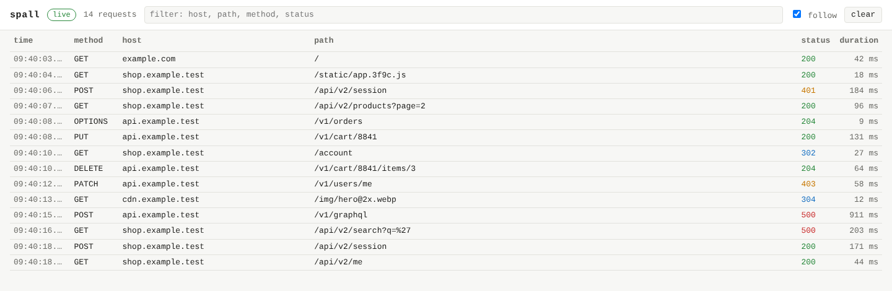

# spall

An assessment workbench for web application security testing: a web UI for interactive testing and an MCP server for agentic testing, built on top of [taphttp](https://github.com/cschooley/taphttp). Findings are exported as [flux](https://github.com/cschooley/flux), a SARIF 2.1.0 profile.

**Status:** pre-alpha. Milestone M0 ("hello": live traffic console). See [docs/architecture.md](docs/architecture.md).

**For authorized testing and local development only.** spall displays raw captured traffic, including credentials. It binds to localhost by default; keep it that way unless you have added authentication.

## Screenshots

### Today: M0 live traffic console



### Where it's going (design mockups, not built yet)

Visual direction from [verdigris](https://github.com/cschooley/verdigris), the suite's design system. The interactive versions live in [`verdigris/mockups`](https://github.com/cschooley/verdigris/tree/main/mockups); the UX behind them is in [docs/ux.md](docs/ux.md).

**Traffic.** Attribution on every exchange (you or the agent), inspector with replay and flag actions.


**Tasks.** The agent works from structured work orders: goal, constraints, request budget, plan and a linked request log. Out-of-scope actions wait for approval. STOP AGENT halts everything.


**Findings.** A triage inbox. The agent proposes, a human confirms, rejects or marks duplicate, with evidence and a redacted export preview.


## Quickstart (M0)

```sh
docker compose up --build
```

taphttp comes from its published image (`ghcr.io/cschooley/taphttp:0.2.0`, amd64 only for now; no login needed). The first `up` compiles spall, which takes a few minutes. Then, in another terminal:

```sh
curl -x http://127.0.0.1:8080 http://example.com
```

Open <http://127.0.0.1:3000> and the request appears in the console. Click a row to see headers and bodies.

Ports:

| Port | Service | Bound to |
|---|---|---|
| 8080 | taphttp HTTP proxy | 127.0.0.1 |
| 3000 | spall web console | 127.0.0.1 |

If either port is already in use, override the host side: `TAPHTTP_PORT=18080 SPALL_PORT=13000 docker compose up`. They stay bound to 127.0.0.1.

### HTTPS

taphttp terminates TLS using its own CA, so clients have to trust that CA. The CA lives in the `taphttp-ca` volume and survives restarts.

The proper way is to export the CA and trust it explicitly:

```sh
docker compose exec taphttp taphttp ca info              # where the cert is, install hints
docker compose exec taphttp taphttp ca print > taphttp-ca.pem
curl -x http://127.0.0.1:8080 --cacert taphttp-ca.pem https://example.com
```

For a quick demo only, you can skip verification:

```sh
curl -x http://127.0.0.1:8080 -k https://example.com
```

**`-k` is for this demo only.** It turns off certificate checking for the whole request. Never use it against anything you care about, and never put it in scripts.

### Running without Docker

```sh
taphttp start --log-file ./traffic.jsonl &
cargo run -- --log-file ./traffic.jsonl
```

| Flag | Env | Default |
|---|---|---|
| `--log-file` | `SPALL_LOG_FILE` | `/data/traffic.jsonl` |
| `--listen` | `SPALL_LISTEN` | `127.0.0.1:3000` |
| `--allowed-host` | `SPALL_ALLOWED_HOSTS` | `localhost,127.0.0.1,[::1]` |
| `--history` | `SPALL_HISTORY` | `1000` (entries replayed to a newly opened page) |
| `--poll-ms` | `SPALL_POLL_MS` | `250` |

`--allowed-host` is checked against the request's `Host` header to block DNS-rebinding attacks on the local console. Requests for any other host get a 403.

## Endpoints

- `GET /`: live console
- `GET /events`: Server-Sent Events, one event per taphttp `TrafficEntry` (JSON); recent history first, then live
- `GET /healthz`: `ok`

## Development

```sh
cargo test
cargo clippy --all-targets -- -D warnings
```

## Provenance

Built with Claude Code, human-directed and reviewed.
